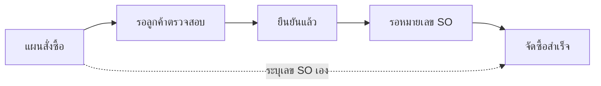
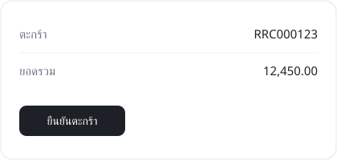

# ตะกร้ายืนยันอย่างไร

ตะกร้าเดินจากแผนสั่งซื้อไปจนจัดซื้อสำเร็จ ข้อนี้อธิบายว่าแต่ละสถานะเกิดจากใคร และระบบทำอะไรต่อ

## สถานะของตะกร้า

| สถานะ | ใครทำ | ระบบทำอะไรต่อ |
|---|---|---|
| แผนสั่งซื้อ | เซล | ยังไม่ส่งไป SPF |
| รอลูกค้าตรวจสอบ | เซล กดส่งให้ลูกค้า | ส่งลิงก์ให้ลูกค้า |
| ยืนยันแล้ว | ลูกค้าหรือ RM | สร้างคำขอใน SPF |
| จัดซื้อสำเร็จ | SPF ส่งเลข SO กลับมา | ดึงรายการจาก SO |

## ทางเดินของตะกร้า

เส้นประคือทางลัดที่ T188 จะปิด

## หน้าจอ

> ยกเลิกตะกร้าได้จนถึงยืนยันแล้วเท่านั้น
